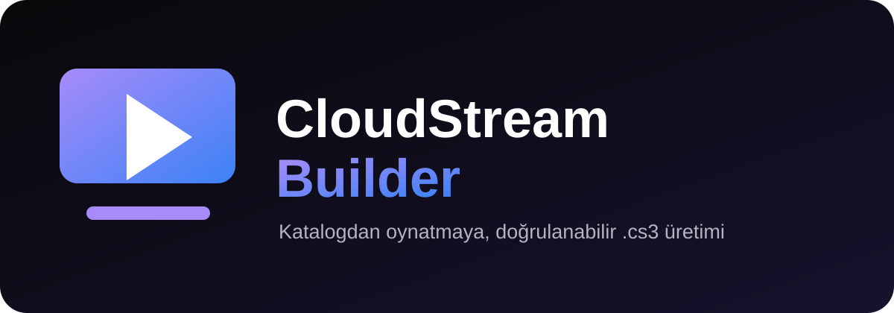

<p align="center">
  
</p>

# CloudStream Builder

**CloudStream eklentileri geliştirmek için açık kaynak bir AI agent skill'i.**

Film, dizi ve canlı yayın sitelerinden `.cs3` eklentileri oluşturma, düzeltme ve test etme sürecinde kodlama ajanlarına yardımcı olur.

## Kurulum

Codex, Antigravity ve diğer desteklenen ajanlar için:

```bash
npx skills add https://github.com/Wiojelt/CloudStream-Builder/tree/main/cloudstream-builder -g
```

Kurulum sırasında kullanmak istediğiniz ajanı seçin. [Skills CLI](https://github.com/vercel-labs/skills) için Node.js gerekir.

## Kullanım

Codex'te örnek:

```text
$cloudstream-builder https://ornek.site için CloudStream eklentisi oluştur.
```

## Bağlantılar

[Skill dosyası](cloudstream-builder/SKILL.md) · [GitHub deposu](https://github.com/Wiojelt/CloudStream-Builder) · [Sorun bildir / katkıda bulun](https://github.com/Wiojelt/CloudStream-Builder/issues)

---

<p align="center"><sub>CloudStream Builder · by <a href="https://github.com/Wiojelt">Wiojelt</a> · Bağımsız topluluk projesi</sub></p>
